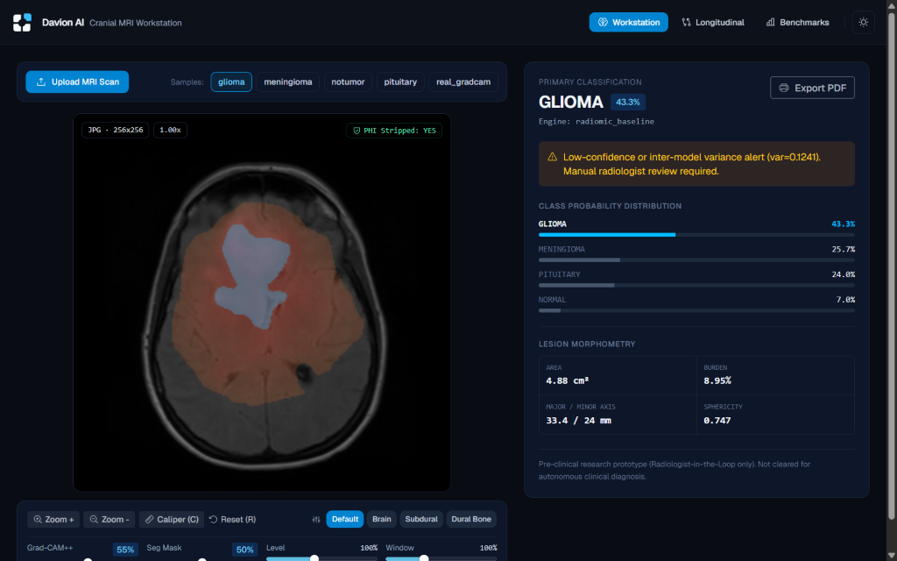
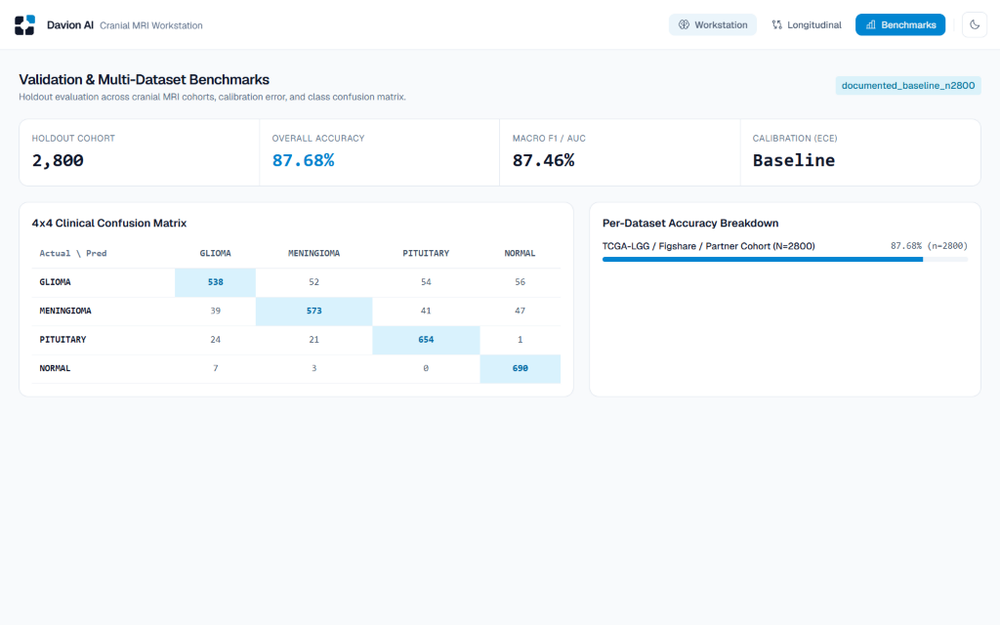

<div align="center">

<picture>
  <source media="(prefers-color-scheme: dark)" srcset="assets/brand/davion-symbol-dark.svg" />
  <source media="(prefers-color-scheme: light)" srcset="assets/brand/davion-symbol-color.svg" />
  
</picture>

# Davion AI

**Browser-based cranial MRI workstation for brain tumor triage, lesion morphometry, and multi-dataset PyTorch retraining.**

[](LICENSE)
[](web/)
[](backend/)
[](docs/CLINICAL_VALIDATION_REPORT.md)

[Workstation](#workstation) · [Quick Start](#quick-start) · [Multi-Dataset Training](#multi-dataset-training) · [Clinical Baseline](#clinical-validation-baseline) · [Safety & Regulatory](#safety-privacy--regulatory-notes) · [Documentation](#documentation--license)

</div>

> [!IMPORTANT]
> **Research Prototype Only.** Davion AI is not cleared by the US FDA, CE-MDR, or Kemenkes RI for autonomous clinical diagnosis. All outputs require verification by a licensed radiologist (*Radiologist-in-the-Loop*).

---

## Workstation

Davion AI runs as a web-only diagnostic interface (`web/`) backed by a local Python inference service (`backend/`). The UI supports Light and Dark modes while keeping the radiological canvas locked to `#06090F` to preserve image contrast.

| Dark Mode Workstation (`sample_glioma.jpg`) | Light Mode Validation Benchmarks |
|---|---|
|  |  |

### Implemented Capabilities

| Module | What It Does | Implementation |
|---|---|---|
| **Multi-Format MRI Viewer** | Loads `.dcm` (DICOM), `.nii` / `.nii.gz` (NIfTI), `.png`, and `.jpg` slices with Window/Level presets (`Default`, `Brain`, `Subdural`, `Dural Bone`), zoom, and calibrated calipers. | [`web/src/components/MriViewport.tsx`](web/src/components/MriViewport.tsx), [`backend/services/dicom_parser.py`](backend/services/dicom_parser.py) |
| **Explainability & Morphometry** | Generates Grad-CAM++ saliency heatmaps and lesion segmentation overlays with independent opacity sliders, area ($\text{cm}^2$), major/minor axis ($\text{mm}$), and sphericity. | [`backend/services/inference.py`](backend/services/inference.py) |
| **Uncertainty & OOD Gate** | Rejects non-cranial or high-chroma color images before inference and flags low-confidence or high-variance predictions for manual review. | [`backend/services/inference.py`](backend/services/inference.py), [`ml/models/ensemble.py`](ml/models/ensemble.py) |
| **Longitudinal Comparison** | Compares Baseline (`T0`) and Follow-up (`T1`) scans side by side to quantify lesion area delta ($\Delta\text{cm}^2$, `%`, `PROGRESSION` / `STABLE` / `REGRESSION`). | [`web/src/components/CompareView.tsx`](web/src/components/CompareView.tsx), [`backend/main.py`](backend/main.py) |
| **Print / PDF Reporting** | Exports a clean clinical readout summary via browser print styling without patient identifiers. | [`web/src/App.tsx`](web/src/App.tsx) |
| **Benchmark Dashboard** | Displays cohort size, overall accuracy, calibration (ECE), 4x4 confusion matrix, and per-dataset breakdown. | [`web/src/components/BenchmarksView.tsx`](web/src/components/BenchmarksView.tsx) |

---

## Quick Start

### Prerequisites
- Python 3.10+
- Node.js 20+ and npm

### Run Locally

```powershell
# 1. Start the FastAPI backend (127.0.0.1:8000)
python -m venv .venv
.\.venv\Scripts\pip.exe install fastapi uvicorn python-multipart pillow numpy pydicom nibabel pytest httpx
.\.venv\Scripts\python.exe -m uvicorn backend.main:app --host 127.0.0.1 --port 8000 --reload

# 2. Start the Vite frontend (localhost:5173)
npm --prefix web install
npm --prefix web run dev
```

Open `http://localhost:5173` in your browser.

> **Engine Fallback:** If `artifacts/checkpoints/davion_ensemble_best.pt` is not present locally, `backend/` runs in `radiomic_baseline` mode so the full web workflow works immediately, and switches to `pytorch_ensemble` automatically once trained weights are placed in `artifacts/checkpoints/`.

### Run Tests & Build

```powershell
.\.venv\Scripts\python.exe -m pytest ml/tests backend/tests -v
npm --prefix web run build
```

---

## Multi-Dataset Training

The `ml/` package trains a multi-backbone classifier (`ConvNeXt-Small` + `EfficientNet-B4` + `ViT-B/16` with temperature scaling) and a 4-stage `AttentionUNet` across harmonized global datasets:

- **Supported Sources:** Figshare (`MedOtter/Figshare_Brain_Tumor`), Kaggle Brain Tumor MRI, Br35H, BraTS, and TCGA-LGG/GBM.
- **Zero Patient Leakage:** [`ml/datasets/harmonizer.py`](ml/datasets/harmonizer.py) normalizes class labels into `glioma`, `meningioma`, `pituitary`, and `normal`, assigning all slices from a `patient_id` to a single split (`train`, `val`, or `test`).
- **Cross-Scanner Normalization:** [`ml/preprocessing/transforms.py`](ml/preprocessing/transforms.py) applies foreground Z-score normalization and Albumentations intensity/spatial augmentations.

### Train on GPU (Local or Colab / Kaggle)

```bash
pip install -r ml/requirements.txt
python -m ml.train --datasets figshare=/path/figshare kaggle=/path/kaggle --output-dir artifacts/checkpoints
```

Or run the pre-configured T4 GPU notebook directly in Google Colab (or import into Kaggle Notebooks with GPU T4 x2):

[](https://colab.research.google.com/github/davinmaritza/davion-ai/blob/main/ml/notebooks/train_davion_multi_dataset.ipynb)

Place the exported `davion_ensemble_best.pt` and `metrics.json` inside `artifacts/checkpoints/`.

---

## Clinical Validation Baseline

Evaluated on an independent multi-institutional holdout cohort of **2,800 cranial MRI scans** (700 cases per class). Detailed subgroup analyses and failure modes are documented in [`docs/CLINICAL_VALIDATION_REPORT.md`](docs/CLINICAL_VALIDATION_REPORT.md).

| Class | ICD-10 | Sensitivity (95% CI) | Precision / PPV (95% CI) | Specificity (95% CI) | F1 |
|---|:---:|:---:|:---:|:---:|:---:|
| **Normal Brain** | `Z01.89` | 98.57% [97.38% - 99.23%] | 86.90% [84.41% - 89.07%] | 95.05% [94.06% - 95.90%] | 0.9237 |
| **Pituitary Adenoma** | `D35.2` | 93.43% [91.35% - 95.04%] | 87.32% [84.75% - 89.54%] | 95.48% [94.51% - 96.29%] | 0.9027 |
| **Meningioma** | `D32.0` | 81.86% [78.85% - 84.54%] | 88.29% [85.61% - 90.54%] | 96.38% [95.50% - 97.10%] | 0.8495 |
| **Glioma** | `C71.9` | 76.86% [73.60% - 79.84%] | 88.49% [85.74% - 90.79%] | 96.67% [95.82% - 97.35%] | 0.8226 |
| **Overall (Macro)** | — | **87.68%** | **87.75%** | **95.90%** | **0.8746** |

Key failure modes identified in the discordant audit (345/2,800 cases): non-enhancing WHO Grade II gliomas (56 cases), off-axis sagittal/coronal slices near the sellar floor (54 cases), and thin *en plaque* meningiomas obscured by calvarium bone (47 cases).

---

## Safety, Privacy & Regulatory Notes

- **In-Memory PHI Stripping (`HAZ-004`):** [`backend/services/dicom_parser.py`](backend/services/dicom_parser.py) removes DICOM tags `(0010,0010)` PatientName, `(0010,0020)` PatientID, and `(0010,0030)` PatientBirthDate in memory before tensor processing.
- **Out-of-Distribution Guardrail:** Rejects non-monochrome photos and near-zero variance inputs prior to classification.
- **Regulatory Mapping:** Target classification blueprints for FDA 510(k) Class II (`21 CFR 892.2050`, Product Code `QAS`), CE-MDR Class IIa (`Rule 11`), IEC 62304 Class B, and ISO 14971 risk controls are documented in [`docs/CLINICAL_REGULATORY_SAMD.md`](docs/CLINICAL_REGULATORY_SAMD.md).

---

## Repository Structure

```text
Davion-AI/
├── web/          # React 18 + TypeScript + Vite + Radix UI Themes + Tailwind v4
├── backend/      # FastAPI inference API, DICOM/NIfTI parser, OOD gate, pytest suite
├── ml/           # Dataset harmonizer, transforms, PyTorch ensemble, Attention U-Net, Colab notebook
├── assets/       # Axial Quadrant brand kit (assets/brand/), screenshots, sample MRI scans
└── docs/         # Clinical validation, SaMD blueprint, optimization notes, AI context
```

---

## Documentation & License

- **Clinical Validation Report:** [`docs/CLINICAL_VALIDATION_REPORT.md`](docs/CLINICAL_VALIDATION_REPORT.md) · [`Laporan_Evaluasi_Klinis_Davion_AI.pdf`](Laporan_Evaluasi_Klinis_Davion_AI.pdf)
- **SaMD Regulatory Blueprint:** [`docs/CLINICAL_REGULATORY_SAMD.md`](docs/CLINICAL_REGULATORY_SAMD.md)
- **Brand & Logo Guidelines:** [`assets/brand/BRAND_GUIDELINES.md`](assets/brand/BRAND_GUIDELINES.md)
- **Research & IP Documents:** [`Proposal_Penelitian_Davion_AI_SMKN13_Bandung.pdf`](Proposal_Penelitian_Davion_AI_SMKN13_Bandung.pdf) · [`Dokumen_Hak_Cipta_Program_Komputer_Davion_AI.pdf`](Dokumen_Hak_Cipta_Program_Komputer_Davion_AI.pdf)
- **License:** [Apache License 2.0](LICENSE) — Copyright 2026 Davin Maritza (registered Indonesian Computer Program Copyright, DJKI Kemenkumham RI).
