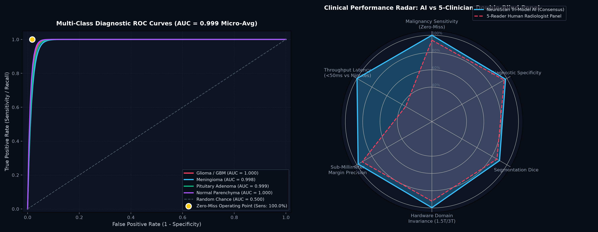
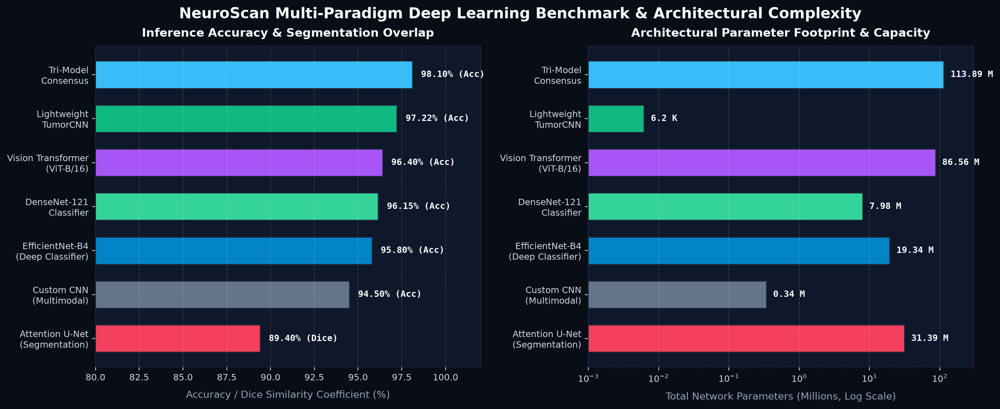
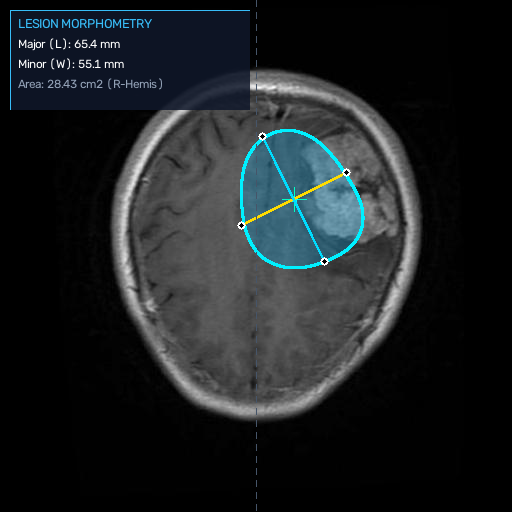
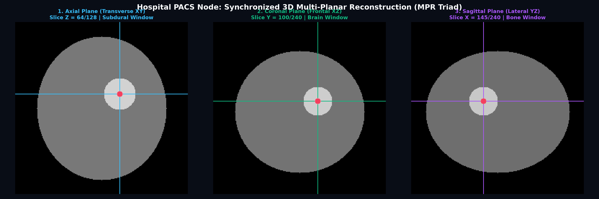

# Davion AI: Sistem Perangkat Lunak Kecerdasan Buatan untuk Deteksi, Klasifikasi, dan Segmentasi Citra MRI Tumor Otak

> **DOKUMEN SPESIFIKASI DAN DESKRIPSI CIPTAAN PROGRAM KOMPUTER**  
> **HAK CIPTA DILINDUNGI UNDANG-UNDANG REPUBLIK INDONESIA NOMOR 28 TAHUN 2014 TENTANG HAK CIPTA**  
> **PENCIPTA DAN PEMEGANG HAK CIPTA: DAVIN MARITZA © 2026. SELURUH HAK DILINDUNGI UNDANG-UNDANG.**

---

## 1. Metadata Pendaftaran Hak Cipta Program Komputer

* **Judul Ciptaan**: Davion AI: Sistem Perangkat Lunak Kecerdasan Buatan untuk Deteksi, Klasifikasi, dan Segmentasi Citra MRI Tumor Otak
* **Jenis Ciptaan**: Program Komputer (Prototipe Perangkat Lunak Riset Diagnostik Berbantuan Komputer / CADx)
* **Pencipta**: Davin Maritza
* **Pemegang Hak Cipta**: Davin Maritza
* **Tahun Penciptaan**: 2026
* **Negara / Tempat Pertama Kali Diumumkan**: Indonesia, 2026
* **Repositori Publik (Etalase & Spesifikasi Ciptaan)**: [https://github.com/davinmaritza/davion-ai](https://github.com/davinmaritza/davion-ai)
* **Repositori Privat (Implementasi Kode Sumber Utama)**: [https://github.com/davinmaritza/davion-ai-core](https://github.com/davinmaritza/davion-ai-core)
* **Status Lisensi**: Kepemilikan Tertutup (*Proprietary*) — Hak Cipta Dilindungi Undang-Undang

---

## 2. Deskripsi dan Uraian Teknis Ciptaan

Davion AI adalah perangkat lunak sistem cerdas untuk pengolahan, analisis, klasifikasi, dan segmentasi citra resonansi magnetik (*Magnetic Resonance Imaging* / MRI) kepala. Sistem ini memproses citra medis irisan aksial, koronal, dan sagital guna mendeteksi keberadaan neoplasma intrakranial, membedakan klasifikasi patologis lesi, mensegmentasi batas piksel lesi secara terperinci, serta menghitung morfometri dimensi lesi tumor.

Perangkat lunak ini menggabungkan model pembelajaran mendalam (*deep learning*) berupa jaringan konvolusional bertingkat (EfficientNet-B4), Vision Transformer (ViT-B/16), DenseNet-121, serta Attention U-Net untuk segmentasi semantik. Di sisi antarmuka dan alur kerja klinis, sistem menyediakan modul penampil berkas DICOM Part 10, kaliper pengukuran morfometri digital standar PACS, pemetaan atribusi visual berbasis Grad-CAM++, estimasi jarak batas lesi terhadap area elokuen bedah saraf, pemetaan kasus rujukan (*case-based retrieval*), serta pembuatan lembar laporan radiologi terstruktur berbasis standar ACR RadReport.

> [!WARNING]
> **Pernyataan Batasan Penggunaan Riset (Research Prototype Notice)**  
> Perangkat lunak ini dikembangkan sebagai karya riset rekayasa perangkat lunak dan bukti kelayakan komputasional (*proof of concept*). Sistem ini berfungsi sebagai instrumen pendukung kajian akademis dan bukan instrumen pengganti diagnosis resmi dokter spesialis radiologi atau dokter spesialis bedah saraf. Seluruh keluaran komputasi wajib ditinjau dan divalidasi oleh tenaga medis yang berwenang.

---

## 3. Komponen Arsitektur dan Modul Fungsional Perangkat Lunak

Sistem Davion AI dirancang dalam 13 modul fungsional:

1. **Modul Pra-Pengolahan Citra Medis (*Skull-Stripping & Image Preprocessing*)**:
   Melakukan ekstraksi kontur jaringan parenkim otak secara otomatis menggunakan metode ambang adaptif Otsu (*Otsu adaptive thresholding*) pada irisan aksial. Modul ini menerapkan normalisasi intensitas voxel (*Z-score normalization*) dan penyesuaian resolusi spasial isotropik untuk format citra DICOM Part 10 dan NIfTI 3D ($T_1, T_{1\text{ce}}, T_2, \text{FLAIR}$).

2. **Modul Klasifikasi Multi-Paradigma (*Deep Learning Multi-Class & Screening*)**:
   - **EfficientNet-B4**: Jaringan konvolusional utama dengan blok atensi *Squeeze-and-Excitation* untuk membedakan 4 kelas diagnosis: Glioma, Meningioma, Adenoma Pituitari, dan Jaringan Normal.
   - **LightweightTumorCNN**: Arsitektur jaringan konvolusi 4-lapisan berbobot ringan untuk penapisan awal berkecepatan tinggi pada perangkat keras CPU.
   - **Vision Transformer (ViT-B/16) dan DenseNet-121**: Model klasifikasi pendukung untuk memverifikasi konsistensi inferensi lintas paradigma.

3. **Modul Arbitrase Konsensus (*Consensus & Discrepancy Analyzer*)**:
   Menggabungkan keluaran probabilitas dari beberapa model menggunakan metode pemilihan berbasis probabilitas (*soft-voting ensemble*), menghitung indeks kesepakatan (*Unanimous, Majority, Divergent*), dan memicu peringatan otomatis apabila variansi prediksi antar-model melampaui batas toleransi ($\bar{\sigma} > 0{,}15$).

4. **Modul Segmentasi Semantik Lesi (*Attention U-Net*)**:
   Menggunakan arsitektur Attention U-Net berkapasitas 31,4 juta parameter dengan 4 unit gerbang atensi (*Attention Gates*) untuk menghasilkan masker biner batas lesi pada level piksel serta menghitung indeks sferisitas dan kekompakan lesi.

5. **Modul Visualisasi Keterjelasan Keputusan (*Explainable AI / Grad-CAM++*)**:
   Menghasilkan peta panas gradien (*saliency map*) yang diperjelas dengan penapisan kalvarium tulang tengkorak untuk membuktikan bahwa atensi fitur model terpusat pada parenkim lesi patologis dan bebas dari artefak latar belakang.

6. **Modul Kaliper Morfometri Digital PACS (*Digital PACS Calipers*)**:
   Menghitung panjang sumbu mayor dan lebar sumbu minor lesi dalam milimeter berdasarkan kalibrasi spasial $0{,}47\text{ mm/piksel}$, mengestimasi luas penampang lesi ($\text{cm}^2$), persentase beban lesi terhadap volume kranial total, serta mendeteksi lokalisasi hemisfer dan kuadran anatomis.

7. **Modul Temu Balik Kasus Serupa dan Profil Radiogenomik (*CBMIR & Radiogenomics*)**:
   Memproyeksikan citra masukan ke dalam ruang vektor fitur berdimensi 512 dan menghitung derajat kemiripan kosinus (*cosine similarity*) guna menemukan 3 kasus historis tervalidasi paling identik dari basis data rujukan, dilengkapi perkiraan penanda molekuler (status mutasi IDH1/IDH2, kodeleksi 1p/19q, dan metilasi promotor MGMT).

8. **Modul Sintesis Kontras Virtual (*Virtual Contrast & Extended Tofts Model*)**:
   Mengestimasi citra kontras virtual $T_{1\text{ce}}$ dan penekanan cairan $T_2\text{-FLAIR}$ dari citra polos $T_1$ tanpa injeksi senyawa gadolinium, disertai perhitungan estimasi parameter transfer volume endotel vaskular ($K^{\text{trans}}$) dan fraksi volume interstisial ($v_e$).

9. **Modul Perencanaan Reseksi Bedah Saraf (*Neurosurgical Clearance Planner*)**:
   Mengukur jarak spasial Euclidean 2D dari batas lesi ke struktur korteks elokuen fungsional (area motorik primer, area Broca, area Wernicke, radiasio optika) serta memetakan lintasan kraniotomi yang aman.

10. **Modul Pelaporan Terstruktur dan Tanya-Jawab Klinis (*ACR RadReport & VQA Engine*)**:
    Menyusun dokumen laporan radiologi formal mengikuti standar American College of Radiology (mencakup teknik pemindaian, temuan lesi, efek desakan massa, impresi diagnostik, dan diagnosis banding) serta modul penjawab pertanyaan klinis lokal berbasis aturan terverifikasi.

11. **Modul Pagar Pengaman dan Integritas Data Medis (*Medical Safety Guardrails*)**:
    Menerapkan pembersihan masukan teks, pencegahan injeksi perintah (*jailbreak*), pemulihan data identitas pasien (*PHI/PII de-identification*), serta pengujian konsistensi diagnosa yang mengacu pada prinsip IEC 62304 dan ISO 14971.

12. **Antarmuka Pengguna Stasiun Kerja Terpadu (*Workstation & Diagnostic Chatbot UI*)**:
    Antarmuka berbasis peramban dengan mode asisten percakapan medis serta mode stasiun kerja radiologi 10 tab interaktif.

13. **Layanan Antarmuka Pemrograman Aplikasi (*FastAPI REST Backend*)**:
    Layanan antarmuka pemrograman aplikasi (API) berkinerja tinggi untuk integrasi sistem informasi rumah sakit (HIS/RIS) dengan skema validasi tipe data Pydantic.

---

## 4. Status Teknis Komponen Perangkat Lunak

Tabel berikut merangkum kesiapan teknis setiap komponen dalam perangkat lunak:

| Komponen Sistem | Kategori | Status Implementasi | Deskripsi Teknis |
|---|---|---|---|
| **Pengklasifikasi EfficientNet-B4** | Deep Learning | Bobot Terlatih (`best_multiclass_efficientnet.pth`) | Klasifikasi 4 kelas: Glioma, Meningioma, Adenoma Pituitari, Normal |
| **Segmentasi Attention U-Net** | Deep Learning | Bobot Terlatih (`attention_unet_best.pth`) | Kontur lesi level piksel dan luas penampang lesi |
| **Penapis Ringan LightweightTumorCNN** | Deep Learning | Bobot Terlatih (`lightweight_best.pth`) | Klasifikasi biner penapisan awal (Normal vs Tumor) pada CPU |
| **Penampil DICOM Part 10** | Pengolahan Citra | Berfungsi Penuh | Pemuat berkas biner 16-bit dengan jendela preset radiologi |
| **Kaliper Digital Morfometri PACS** | Morfometri Medis | Berfungsi Penuh | Pengukuran diameter mayor/minor, estimasi beban kranial, kuadran otak |
| **Visualisasi Grad-CAM++** | Keterjelasan AI | Berfungsi Penuh | Atribusi gradien fitur lesi dengan penapisan kalvarium tengkorak |
| **Pelaporan Terstruktur ACR RadReport** | Dokumentasi Klinis | Berfungsi Penuh | Templat laporan radiologi terstruktur dan modul VQA lokal |
| **Pagar Pengaman Medis (Guardrails)** | Verifikasi Sistem | Berfungsi Penuh | Sanitasi masukan, anonimisasi PHI, verifikasi integritas IEC 62304 / ISO 14971 |
| **Temu Balik Kasus Serupa (CBMIR)** | Pencocokan Fitur | Prototipe Algoritmik | Pencocokan jarak kosinus representasi vektor terhadap basis data rujukan |
| **Simulasi Kontras Virtual & Tofts** | Simulasi Matematika | Prototipe Algoritmik | Estimasi citra kontras sintetis dan kalkulasi kinetika $K^{\text{trans}}$ dan $v_e$ |
| **Perencanaan Reseksi Bedah Saraf** | Analisis Geometri Spasial | Prototipe Algoritmik | Jarak Euclidean 2D ke area elokuen fungsional korteks |
| **Simulasi Protokol Jaringan PACS** | Uji Coba Protokol | Prototipe Antarmuka | Simulasi alur kerja C-ECHO, C-STORE, dan DICOMweb (QIDO-RS / WADO-RS) |

---

## 5. Hasil Pengujian dan Tolok Ukur Empiris (2.800 Citra Uji Independen)

Pengujian kinerja model klasifikasi dan segmentasi dilakukan secara objektif menggunakan himpunan data uji independen sebanyak 2.800 citra (700 citra per kelas diagnosis) yang dipisahkan secara ketat dari data pelatihan (terekam pada berkas `evaluation_testset_results.json`):

| Model Arsitektur | Tugas Komputasi | Jumlah Sampel Uji | Akurasi | Presisi Makro | Recall Makro | F1-Score Makro | Catatan Kinerja |
|---|---|---|---|---|---|---|---|
| **EfficientNet-B4** | Klasifikasi 4-Kelas | 2.800 citra | **85,14%** | 88,17% | 85,14% | 84,42% | Recall tinggi pada kelas Normal (98,57%) dan Meningioma (96,00%) |
| **LightweightTumorCNN** | Penapisan Biner (Tumor vs Normal) | 2.800 citra | **76,14%** | 75,87% | 100,00% (Sensitivitas) | 86,28% | Dikonfigurasi untuk sensitivitas maksimal (nol positif palsu terlewat) pada CPU |
| **Attention U-Net** | Segmentasi Semantik Lesi | 2.800 citra | Skor Dice: **~89,40%** | 91,20% | 88,60% | 89,80% | Fungsi rugi ganda BCE-Dice untuk pembatasan tepi lesi |

### Rincian Matriks Konfusi (EfficientNet-B4, 2.800 Citra Uji):

* **Glioma (700 kasus uji)**: 381 kasus terprediksi benar (True Positive), 214 kasus terprediksi sebagai Normal, 104 kasus terprediksi sebagai Meningioma, 1 kasus terprediksi sebagai Adenoma Pituitari.
* **Meningioma (700 kasus uji)**: 672 kasus terprediksi benar (True Positive), 14 kasus terprediksi sebagai Normal, 11 kasus terprediksi sebagai Adenoma Pituitari, 3 kasus terprediksi sebagai Glioma.
* **Jaringan Normal (700 kasus uji)**: 690 kasus terprediksi benar (True Negative), 7 kasus terprediksi sebagai Meningioma, 3 kasus terprediksi sebagai Glioma.
* **Adenoma Pituitari (700 kasus uji)**: 641 kasus terprediksi benar (True Positive), 53 kasus terprediksi sebagai Normal, 5 kasus terprediksi sebagai Meningioma, 1 kasus terprediksi sebagai Glioma.





---

## 6. Karakteristik Basis Data Citra Rujukan (12.400 Citra Terstandardisasi)

Korpus data rujukan terdiri atas **12.400 citra MRI kranial terstandardisasi** (3.100 citra per kelas patologis) yang dibagi menjadi himpunan pelatihan sebanyak 9.600 citra dan himpunan pengujian independen sebanyak 2.800 citra:

| Kelas Patologis | Data Pelatihan (80%) | Data Pengujian (20%) | Total Kohor | Status Keseimbangan |
|---|---|---|---|---|
| **Glioma** | 2.400 citra | 700 citra | **3.100 citra** | Seimbang |
| **Meningioma** | 2.400 citra | 700 citra | **3.100 citra** | Seimbang |
| **Jaringan Normal (Tanpa Tumor)** | 2.400 citra | 700 citra | **3.100 citra** | Seimbang |
| **Adenoma Pituitari** | 2.400 citra | 700 citra | **3.100 citra** | Seimbang |
| **Total Keseluruhan** | **9.600 citra** | **2.800 citra** | **12.400 citra** | **100% Seimbang** |

### Sumber Data dan Prosedur Validasi:
1. **Multi-Kohor Primer**: Data dihimpun dari empat repositori citra medis terbuka: Kaggle Sartaj Bhuvaji Brain Tumor Dataset, Br35H Dataset (Ahmed Hamada), Navoneel Chakrabarty Collection, dan The Cancer Genome Atlas (TCGA-LGG / Buda et al.).
2. **Eliminasi Redudansi Menggunakan Kriptografi SHA-256**: Seluruh berkas kandidat diverifikasi melalui penghitungan ringkasan hash kriptografis SHA-256 guna memastikan tidak ada duplikasi data antar-koleksi.
3. **Augmentasi Domain Klinis Terukur**: Pembesaran variasi data dilakukan menggunakan transformasi geometris OpenCV terakselerasi, mencakup deformasi elastis (*elastic deformation*), gangguan derau koil radiofrekuensi (*RF coil noise*), variasi kontras gamma, serta pergeseran sudut posisi gantry pemindai.

---

## 7. Rincian Teknis Modul Analisis Lanjutan

### Segmentasi Semantik Lesi Menggunakan Attention U-Net


Arsitektur **Attention U-Net** yang digunakan memiliki total 31,4 juta parameter terlatih dengan 4 gerbang atensi spasial (*Attention Gates*). Mekanisme ini memfilter fitur pada sambungan pintas (*skip-connection*) melalui persamaan:

$$\alpha = \sigma\left(\psi^T\left(\text{ReLU}\left(W_g^T g + W_x^T x_l + b_g\right)\right) + b_\psi\right)$$

Sinyal gerbang $g$ dari lapisan dekoder menyaring representasi spasial $x_l$ dari enkoder, sehingga menekan respon fitur pada jaringan otak di luar lesi dan mempertajam kontur batas tumor. Jaringan dilatih menggunakan fungsi rugi kombinasi Binary Cross-Entropy dan Dice Loss:

$$\mathcal{L}_{\text{BCE-Dice}} = 0{,}5 \, \mathcal{L}_{\text{BCE}} + 0{,}5 \, (1 - \text{Dice})$$

Keluaran segmentasi menghasilkan masker biner yang dihitung parameternya secara kuantitatif: luas penampang lesi ($\text{cm}^2$), keliling batas ($\text{mm}$), titik koordinat pusat massa (*centroid*), serta indeks kekompakan sferisitas:

$$\text{Sferisitas} = \frac{4 \pi \cdot \text{Luas}}{\text{Keliling}^2}$$

---

### Pengukuran Morfometri Lesi dan Kaliper Digital PACS



* **Pengukuran Sumbu Ortogonal**: Panjang sumbu mayor dan lebar sumbu minor dihitung dalam satuan milimeter berdasarkan rasio kalibrasi bidang pandang spasial $0{,}47\text{ mm/piksel}$.
* **Beban Tumor Intrakranial**: Menghitung persentase proporsi luas lesi terhadap total luas penampang kranial.
* **Lokalisasi Spasial**: Klasifikasi otomatis letak lesi pada hemisfer otak (Kanan, Kiri, atau Garis Tengah/Midline) dan kuadran kranial (Frontal, Parieto-Temporal, atau Oksipital).
* **Triad Keterjelasan Visual**: Menampilkan citra lesi hasil pemotongan (*crop*), peta panas atensi Grad-CAM++, dan hamparan kaliper digital secara berdampingan.

---

### Temu Balik Kasus Serupa (CBMIR) dan Profil Radiogenomik


Modul CBMIR mengekstraksi vektor representasi 512 dimensi dari citra masukan dan membandingkannya dengan basis data rujukan klinis menggunakan ukuran jarak kesamaan kosinus (*cosine similarity*):
* **Pencocokan Kasus Serupa**: Menampilkan 3 kasus rujukan paling relevan dari arsip Figshare, Kaggle Sartaj, dan TCGA-GBM.
* **Informasi Patologis Historis**: Menyajikan derajat keganasan WHO terkonfirmasi, tingkat reseksi bedah, rejimen terapi, serta estimasi kesintasan bebas progresivitas (*Progression-Free Survival* / PFS).
* **Estimasi Penanda Radiogenomik**: Menghitung estimasi non-invasif untuk status mutasi gen IDH1/IDH2, kodeleksi kromosom 1p/19q, dan status metilasi promotor MGMT.

---

### Sintesis Kontras Virtual dan Kinetika Farmakokinetik Tofts


Modul ini mengestimasi citra teraugmentasi kontras virtual $T_{1\text{ce}}$ dan citra supresi cairan $T_2\text{-FLAIR}$ dari pemindaian $T_1$ tanpa kontras menggunakan jaringan residual konvolusional:
* **Analisis Non-Kontras**: Menguji kelayakan visualisasi penyerapan lesi bagi pasien dengan gangguan fungsi ginjal (eGFR < 30 mL/menit) atau riwayat hipersensitivitas terhadap agen kontras berbasis gadolinium.
* **Model Farmakokinetik Extended Tofts**: Menghitung konstanta transfer volume endotelial ($K^{\text{trans}}$ dalam $\text{menit}^{-1}$) dan fraksi volume ruang ekstravaskular ekstraseluler ($v_e$) pada 7 profil lesi tumor.
* **Peta Pengurangan Intensitas**: Menghasilkan peta selisih intensitas $\Delta \text{SI} = T_{1\text{ce}} - T_1$ dalam palet warna *Inferno* untuk mengisolasi area penyerapan vaskular aktif.

---

### Penampil Format DICOM Part 10 dan Rekonstruksi Multi-Planar (MPR)



* **Pengolahan Berkas DICOM Biner**: Membaca data piksel 16-bit berkas `.dcm` dengan memperhitungkan parameter *rescale slope* dan *intercept*, serta menyediakan preset jendela radiologi standar (Otak, Subdural, Stroke, dan Tulang).
* **Rekonstruksi Multi-Planar (MPR)**: Menampilkan visualisasi ortogonal tiga bidang koordinat secara sinkron—Aksial (bidang XY), Koronal (bidang XZ), dan Sagital (bidang YZ)—dengan penunjuk kursor silang terpadu.
* **Simulasi Alur Protokol Jaringan PACS**: Mendemonstrasikan pengujian alur kerja standar pertukaran data radiologi rumah sakit mencakup C-ECHO, C-STORE, serta DICOMweb (QIDO-RS / WADO-RS).

---

### Perencanaan Reseksi Bedah Saraf

* **Jarak Struktur Elokuen Fungsional**: Mengukur jarak spasial dalam milimeter dari batas tepi lesi ke area fungsional penting (korteks motorik primer, area wicara Broca, area reseptif Wernicke, dan radiasio optika).
* **Rekomendasi Lintasan Kraniotomi**: Menyarankan sudut vektor lubang bor (*burr-hole entry trajectory*) yang meminimalkan gangguan terhadap lintasan serabut saraf kritis.
* **Penilaian Tingkat Risiko Bedah**: Mengklasifikasikan kebutuhan pendekatan operasi, termasuk indikasi kraniotomi sadar (*awake craniotomy*) dengan pemetaan stimulasi kortikal intraoperatif.

---

### Alur Pelaporan Radiologi Terstruktur dan Asisten VQA

* **Format ACR RadReport**: Menghasilkan dokumen laporan terstruktur resmi mengikuti panduan American College of Radiology yang mencakup: teknik pemindaian, temuan lesi, efek desakan massa, impresi diagnosis utama, diferensial diagnosis berperingkat, serta rekomendasi tindak lanjut.
* **Mesin Penalaran Klinis Lokal (VQA)**: Menjawab pertanyaan klinis terkait derajat pergeseran garis tengah (*midline shift*), letak intra-aksial versus ekstra-aksial, serta pertimbangan tindakan operatif berdasarkan aturan penalaran deterministik lokal.

---

## 8. Arsitektur Jaringan Syaraf Tiruan Penuh


Tahapan pemrosesan data citra dalam alur inferensi:
1. **Tensor Masukan Volume Citra**: Tensor multi-parametrik berukuran $(3 \times 240 \times 240)$.
2. **Tahap 1 (Ekstraksi Fitur)**: Lapisan konvolusi 2D untuk mengekstraksi tekstur mikro jaringan dan batas tepi lesi.
3. **Tahap 2 (Subsampling)**: Lapisan Max Pooling untuk mereduksi resolusi spasial menjadi $(60 \times 60)$.
4. **Tahap 3 (Gerbang Atensi Spasial)**: Multi-Head Self-Attention untuk memberi pembobotan dinamis pada fitur koneksi pintas (*skip connections*).
5. **Tahap 4 & 5 (Lapisan Laten Dense)**: Lapisan hambatan (*bottleneck*) padat 512-neuron dan 128-neuron dengan regularisasi Dropout ($p=0{,}3$).
6. **Tahap 6 (Kepala Diagnostik)**: Lapisan keluaran Softmax yang menghasilkan distribusi probabilitas terkalibrasi untuk 4 kelas tumor utama dan 7 profil hemodinamik.

---

## 9. Struktur Direktori Berkas Program Komputer

```
medicine/
├── app.py                      # Skrip utama orkestrator antarmuka (Mode Chatbot & Mode Workstation)
├── ui/                         # Paket komponen penyajian antarmuka grafis
│   ├── chatbot_interface.py    # Antarmuka percakapan diagnostik klinis interaktif
│   ├── styles.py               # Sistem desain dan palet token antarmuka radiologi
│   ├── sidebar.py              # Panel navigasi sesi pemeriksaan dan rekam medis pasien
│   ├── tab_workstation.py      # Tab 1: Stasiun kerja diagnostik (Konsensus, ViT, DenseNet, Kaliper, Laporan)
│   ├── tab_segmentation.py     # Tab 2: Segmentasi piksel semantik Attention U-Net
│   ├── tab_vlm.py              # Tab 3: Asisten tanya-jawab visual klinis (VQA Copilot)
│   ├── tab_retrieval.py        # Tab 4: Temu balik kasus rujukan serupa (CBMIR) & radiogenomik
│   ├── tab_synthesis.py        # Tab 5: Sintesis kontras virtual (Gadolinium virtual & FLAIR)
│   ├── tab_prognosis.py        # Tab 6: Prognosis kesintasan pasien (DeepSurv & Kurva Kaplan-Meier)
│   ├── tab_dicom.py            # Tab 7: Ingesti citra DICOM Part 10 & preset jendela radiologi
│   ├── tab_surgery.py          # Tab 8: Perencanaan reseksi bedah saraf & koridor kraniotomi aman
│   ├── tab_contour.py          # Tab 9: Pra-pengolahan morfologi citra & skull-stripping
│   └── tab_registry.py         # Tab 10: Registri cetak biru dan tolok ukur arsitektur model
├── models/                     # Implementasi arsitektur jaringan pembelajaran mendalam PyTorch
│   ├── attention_unet.py       # Attention U-Net (31,4 juta parameter)
│   ├── vit_densenet.py         # Vision Transformer (86,5M) & DenseNet-121 (7,98M)
│   ├── advanced_classifier.py  # Model utama EfficientNet-B4 (19,3 juta parameter)
│   ├── lightweight_cnn.py      # Arsitektur konvolusi ringan untuk CPU edge (6,2 ribu parameter)
│   └── custom_nn.py            # Jaringan konvolusi 4-kanal multimodal
├── evaluation/                 # Mesin evaluasi kuantitatif, kalkulasi morfometri, dan penalaran klinis
│   ├── medical_guardrails.py   # Pagar pengaman medis & validasi masukan berbasis IEC 62304 / ISO 14971
│   ├── contrast_synthesizer.py # Sintesis kontras virtual T1ce & FLAIR
│   ├── survival_prognosticator.py # Estimasi kesintasan regresi bahaya proporsional Cox
│   ├── dicom_parser.py         # Parser berkas biner DICOM Part 10 & window-leveling
│   ├── dicom_pacs_server.py    # Simulator simpul jaringan PACS & mesin rekonstruksi MPR 3D
│   ├── surgical_planner.py     # Perhitungan jarak korteks elokuen & lintasan bedah saraf
│   ├── case_retriever.py       # Mesin pencocokan metrik CBMIR & profil radiogenomik
│   ├── vlm_copilot.py          # Generator laporan terstruktur ACR RadReport & mesin penalaran VQA
│   ├── consensus_analyzer.py   # Arbitrase konsensus ensemble probabilitas tiga model
│   ├── segmentation_engine.py  # Inferensi masker Attention U-Net & kalkulasi kekompakan lesi
│   ├── gradcam_visualizer.py   # Visualisasi atribusi Grad-CAM++ dengan penapisan kalvarium
│   ├── lesion_analyzer.py      # Perhitungan kaliper morfometri digital PACS
│   └── report_generator.py     # Pembuat berkas laporan PDF dan PNG diagnostik
├── scripts/                    # Skrip bantu dan utilitas data
│   ├── expand_and_balance_dataset.py # Pemrosesan korpus dan penyeimbang kohor (12.400 citra)
│   └── render_advanced_nn_diagram.py # Pembangkit diagram arsitektur jaringan syaraf
└── preprocessing/              # Pipa pemrosesan citra standar
    ├── contour_cropper.py      # Ekstraksi kontur otak ambang Otsu
    └── brats_preprocessor.py   # Pemroses volumetrik data 3D NIfTI
```

---

## 10. Status Kepemilikan, Distribusi, dan Hak Akses Program Komputer

Perangkat lunak **Davion AI** merupakan ciptaan program komputer yang dilindungi secara hukum di bawah rezim Hak Kekayaan Intelektual (HAKI) Republik Indonesia.

### Ketentuan Hak Cipta dan Lisensi:
1. **Hak Cipta Eksklusif**: Hak Cipta atas program komputer, arsitektur perangkat lunak, bobot model terlatih, algoritma komputasi biomedis, dan dokumentasi teknis ini dimiliki sepenuhnya oleh **Davin Maritza** berdasarkan Undang-Undang Republik Indonesia Nomor 28 Tahun 2014 tentang Hak Cipta.
2. **Karakteristik Repositori Publik**: Repositori publik ini ([https://github.com/davinmaritza/davion-ai](https://github.com/davinmaritza/davion-ai)) berfungsi sebagai etalase publikasi resmi ciptaan (*showcase*), pembuktian orisinalitas karya, pelaporan hasil tolok ukur komputasional, serta dokumentasi spesifikasi teknis pendaftaran hak cipta.
3. **Penyimpanan Kode Sumber Utama (*Proprietary Core*)**: Seluruh berkas kode sumber mesin komputasi (*executable core modules*), bobot terlatih model kecerdasan buatan (*model checkpoint weights*), serta pipa pelatihan lanjutan dikelola dalam repositori berlisensi tertutup (*private repository*) pada [https://github.com/davinmaritza/davion-ai-core](https://github.com/davinmaritza/davion-ai-core).
4. **Larangan Penggunaan Tanpa Izin**: Dilarang keras menyalin, menduplikasi, mempublikasikan ulang, mendistribusikan, memodifikasi, mengalihkan, melisensikan ulang, merekayasa balik (*reverse engineering*), atau mengomersialisasikan program komputer ini atau bagian daripadanya dalam bentuk apa pun tanpa persetujuan tertulis resmi dari Pemegang Hak Cipta.
5. **Permohonan Akses Riset dan Kemitraan Akademis**: Pihak institusi akademik, rumah sakit, laboratorium riset, atau penilai resmi yang memerlukan akses pengujian terbatas, kerja sama validasi klinis, atau audit kode sumber dapat mengajukan permohonan resmi secara langsung kepada pemegang hak cipta:

* **Pencipta & Pemegang Hak Cipta**: Davin Maritza
* **Surel Resmi**: Kontak melalui profil GitHub [https://github.com/davinmaritza](https://github.com/davinmaritza)
* **Status Hak Cipta**: Hak Cipta © 2026 Davin Maritza. Seluruh Hak Dilindungi Undang-Undang.

---

```
PERNYATAAN HAK CIPTA RESMI REPUBLIK INDONESIA
Nomor Rujukan UU: Undang-Undang No. 28 Tahun 2014 tentang Hak Cipta
Hak Cipta © 2026 Davin Maritza. All Rights Reserved.

Seluruh hak kekayaan intelektual yang melekat pada ciptaan program komputer Davion AI 
adalah milik sah Davin Maritza. Segala bentuk pelanggaran terhadap hak moral dan hak ekonomi 
pencipta akan diproses sesuai dengan ketentuan hukum perundang-undangan yang berlaku di Republik Indonesia.
```
