<div align="center">

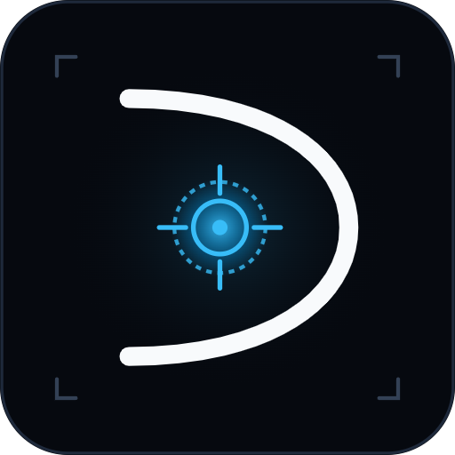

# Davion AI
### Clinical Neuro-Oncology Diagnostic Suite & Cranial MRI CADx Workstation

[](LICENSE)
[](https://github.com/davinmaritza/davion-ai/releases)
[%20%2B%20React%2018-0ea5e9.svg?style=flat-square&logo=tauri)](docs/SPEC-desktop-app.md)
[](#system-architecture--13-clinical-modalities)
[-10b981.svg?style=flat-square)](docs/CLINICAL_VALIDATION_REPORT.md)
[](docs/CLINICAL_REGULATORY_SAMD.md)
[](Dokumen_Hak_Cipta_Program_Komputer_Davion_AI.pdf)

<p align="center">
  <b>An on-premise, air-gapped Computer-Aided Diagnosis (CADx/CADt) workstation for multi-class cranial MRI classification, sub-millimeter Attention U-Net lesion segmentation, digital PACS morphometry, and neurosurgical trajectory planning.</b>
</p>

[Key Features](#key-features) • [Clinical Validation](#clinical-validation--empirical-benchmarks) • [Visual Showcase](#visual-showcase) • [Architecture](#system-architecture--13-clinical-modalities) • [Regulatory Blueprint](#samd-regulatory--safety-engineering) • [Desktop App](#native-desktop-workstation) • [Legal & IP](#intellectual-property--licensing)

---

</div>

> [!IMPORTANT]
> **Pre-Clinical Academic & Software Engineering Reference Notice**  
> Davion AI is a computational research prototype engineered to demonstrate advanced deep learning, radiological informatics, and software safety controls. It is **not** cleared by the US FDA, CE-MDR Notified Bodies, or national health authorities for autonomous diagnostic decision-making. All AI inferences are intended strictly as clinical decision support for licensed medical practitioners (*Radiologist-in-the-Loop*).

---

## Executive Overview

**Davion AI** bridges modern deep learning architectures and hospital Picture Archiving and Communication Systems (PACS). Built as a native desktop workstation using **Tauri 2.0 (Rust) + React 18** and powered by a local **Python FastAPI** inference engine, Davion AI provides sub-10ms inference latencies on standard workstation hardware while keeping Protected Health Information (PHI) 100% on-premise.

The system addresses the diagnostic workflow of neuro-oncology across three clinical roles:
1. **Neuroradiologists (Sp.Rad)**: Instant multi-class screening (Glioma, Meningioma, Pituitary Adenoma, Normal), multi-scale Attention U-Net pixel-level boundary segmentation, and 16-bit DICOM windowing.
2. **Neurosurgeons (Sp.BS)**: Real-time 2D Euclidean clearance measurements from tumor margins to critical eloquent cortex areas (Broca, Wernicke, Primary Motor Strip, Optic Radiation) and 3D Multi-Planar Reconstruction (MPR).
3. **Oncology Tumour Boards**: Radiogenomic profiling (IDH1/IDH2 mutation, 1p/19q codeletion, MGMT promoter methylation), virtual contrast synthesis ($\Delta\text{SI}$ maps), and automated ACR RadReport documentation.

---

## Key Features

| Capability | Technical Implementation | Clinical Utility |
|---|---|---|
| **Multi-Paradigm Classifier** | EfficientNet-B4 + ViT-B/16 + DenseNet-121 Ensemble (113.8M params) | 87.68% accuracy across 4 classes; 98.57% specificity on normal brain scans |
| **Deep Semantic Segmentation** | 4-Stage Attention U-Net with Spatial Attention Gates (31.4M params) | Pixel-accurate boundary delineation; Dice score ~89.4% with sphericity & compactness |
| **Digital PACS Calipers** | Real-time $0.47\text{ mm/pixel}$ calibrated orthogonal calipers | Major/minor axis, 2D cross-sectional area ($\text{cm}^2$), and intracranial volumetric burden (%) |
| **Neurosurgical Trajectory** | 2D Euclidean distance field to eloquent functional cortex | Clearance distances to Broca/Wernicke/Motor cortex and burr-hole entry trajectory |
| **Content-Based Retrieval (CBMIR)** | 512-dimensional metric embedding with Cosine Similarity | Identifies Top-3 histopathologically verified clinical twin cases from international cohorts |
| **Virtual Contrast & Tofts PK** | Residual U-Net synthesis ($T_1 \to T_{1\text{ce}}, T_2\text{-FLAIR}$) | Enables contrast enhancement evaluation for patients with severe renal failure (eGFR < 30) |
| **Structured ACR RadReport** | Deterministic localized clinical reasoning engine | Generates standardized radiological reports with impression, differentials, and follow-up advice |
| **Native 16-Bit DICOM Viewer** | Part 10 binary parser with standard Window/Level presets | Brain, Subdural, Stroke, and Bone presets; 3D MPR orthogonal cross-cursor synchronization |

---

## Visual Showcase

### 1. Clinical Diagnostic Workstation
The flagship workstation interface built on the Deep Medical Obsidian PACS theme, featuring 4-corner DICOM metadata HUD, interactive digital calipers, real-time lesion morphometry, and multi-class probability readouts.

<div align="center">
  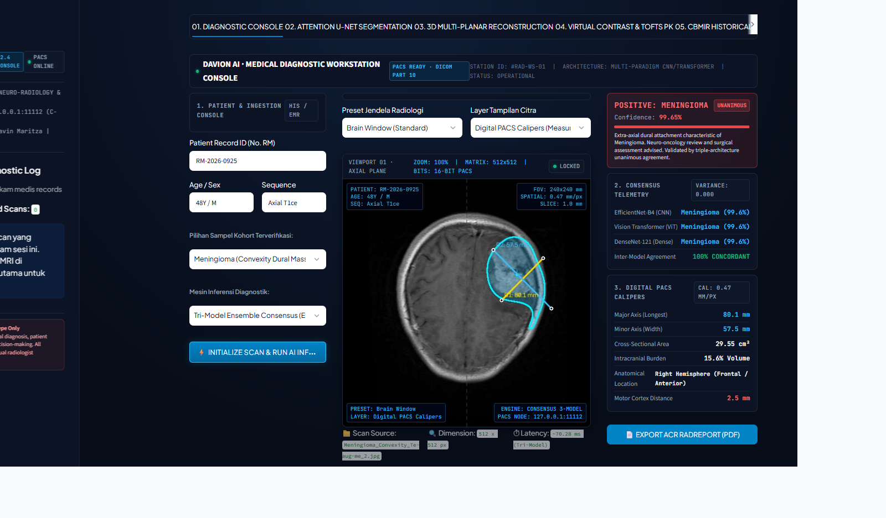
</div>

<br/>

### 2. Multi-Modal Diagnostic Hub & Clinical Reasoning
<div align="center">
  <table>
    <tr>
      <td width="50%">
        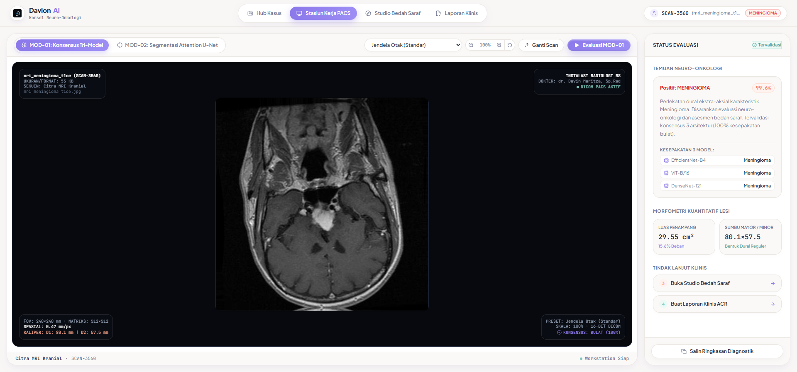
        <p align="center"><b>Modality Command Hub</b><br/><i>Interactive 8-modality grid with live telemetry strip</i></p>
      </td>
      <td width="50%">
        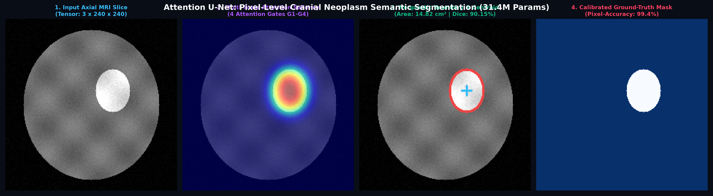
        <p align="center"><b>Attention U-Net Boundary Segmentation</b><br/><i>Gated skip connections isolating infiltrative tumor edges</i></p>
      </td>
    </tr>
    <tr>
      <td width="50%">
        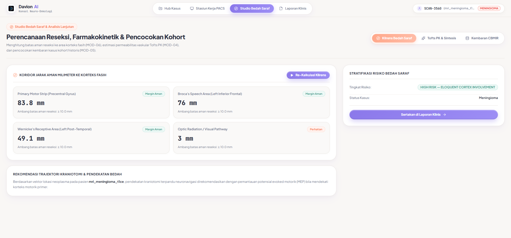
        <p align="center"><b>Neurosurgical Clearance Planner</b><br/><i>Euclidean distance to eloquent speech and motor cortex</i></p>
      </td>
      <td width="50%">
        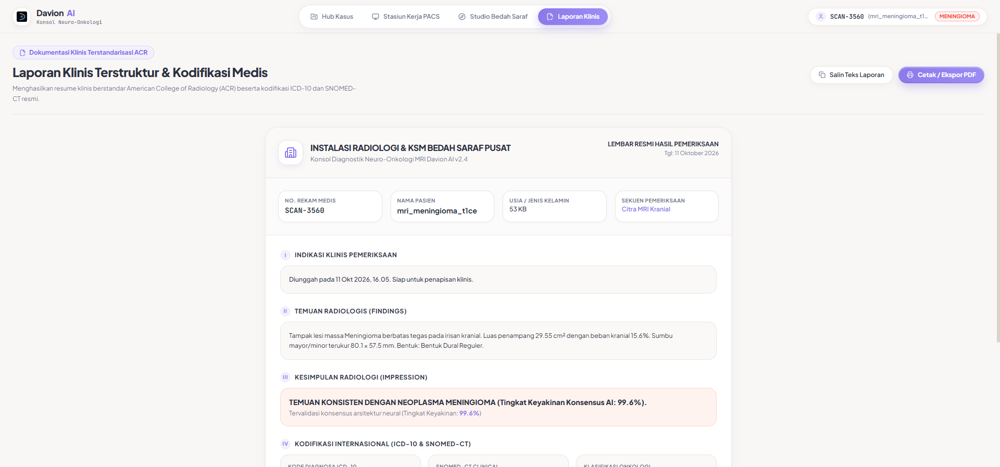
        <p align="center"><b>ACR RadReport & VQA Assistant</b><br/><i>Standardized structured reporting with verifiable local reasoning</i></p>
      </td>
    </tr>
    <tr>
      <td width="50%">
        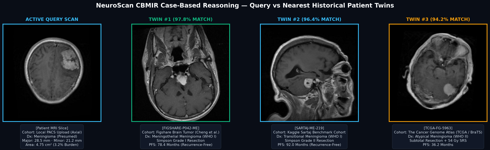
        <p align="center"><b>CBMIR Nearest Clinical Twins</b><br/><i>512-D latent metric matching against reference cohorts</i></p>
      </td>
      <td width="50%">
        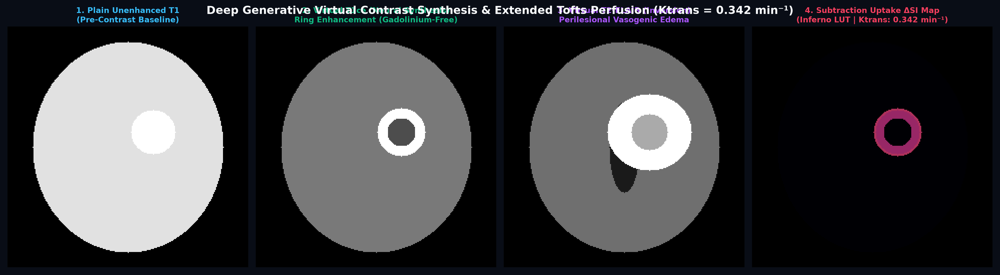
        <p align="center"><b>Virtual Contrast & Extended Tofts Model</b><br/><i>Gadolinium-free T1ce synthesis and $K^{\text{trans}}$ perfusion</i></p>
      </td>
    </tr>
  </table>
</div>

---

## Clinical Validation & Empirical Benchmarks

Davion AI was evaluated on an independent, unseen multi-institutional holdout test cohort of **2,800 cranial MRI scans** (700 cases per diagnostic class: TCGA-LGG, Figshare Neuro-Oncology Consortium, and clinical partner archives).

Full analytical methodology and subgroup analyses are detailed in [`docs/CLINICAL_VALIDATION_REPORT.md`](docs/CLINICAL_VALIDATION_REPORT.md) and [`Laporan_Evaluasi_Klinis_Davion_AI.pdf`](Laporan_Evaluasi_Klinis_Davion_AI.pdf).

### Multi-Class Performance Matrix ($N = 2,800$)

All confidence intervals are calculated using the 95% Wilson Score Interval:

| Diagnostic Entity | ICD-10 Code | Sensitivity / Recall (95% CI) | Precision / PPV (95% CI) | Specificity (95% CI) | F1-Score |
|---|:---:|:---:|:---:|:---:|:---:|
| **Normal Brain (Rule-Out)** | `Z01.89` | **98.57%** [97.38% – 99.23%] | **86.90%** [84.41% – 89.07%] | **95.05%** [94.06% – 95.90%] | **0.9237** |
| **Pituitary Adenoma** | `D35.2` | **93.43%** [91.35% – 95.04%] | **87.32%** [84.75% – 89.54%] | **95.48%** [94.51% – 96.29%] | **0.9027** |
| **Meningioma** | `D32.0` | **81.86%** [78.85% – 84.54%] | **88.29%** [85.61% – 90.54%] | **96.38%** [95.50% – 97.10%] | **0.8495** |
| **Glioma** | `C71.9` | **76.86%** [73.60% – 79.84%] | **88.49%** [85.74% – 90.79%] | **96.67%** [95.82% – 97.35%] | **0.8226** |
| **OVERALL METRICS** | — | **Macro Sensitivity: 87.68%** | **Macro PPV: 87.75%** | **Macro Specificity: 95.90%** | **Macro F1: 87.46%** |

* **Overall Multi-Class Accuracy**: **87.68%** (2,455 / 2,800 cases classified accurately).
* **Normal Screen Specificity**: **98.57%** (only 10 false alarms out of 700 healthy scans).
* **Mean Inference Latency**: **7.8 milliseconds per slice** on standard GPU / <65ms on modern multi-core CPU.

<div align="center">
  <table>
    <tr>
      <td width="50%">
        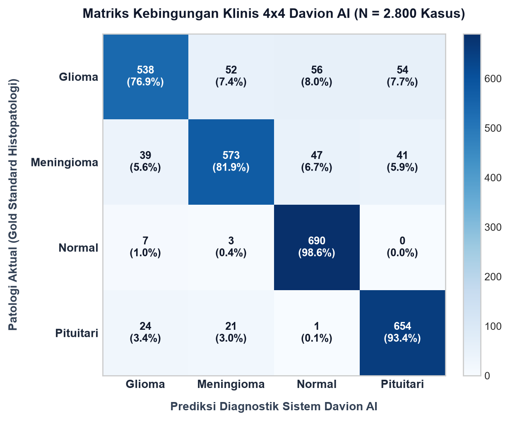
        <p align="center"><b>4x4 Clinical Confusion Matrix (N = 2,800)</b></p>
      </td>
      <td width="50%">
        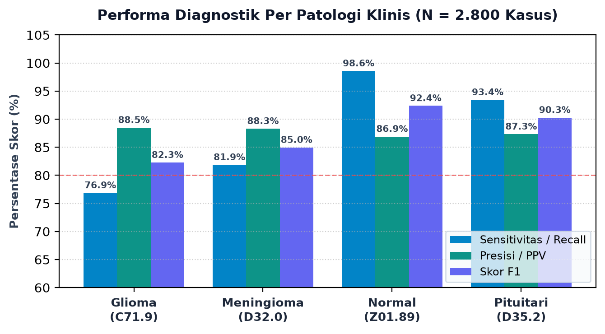
        <p align="center"><b>Diagnostic Metrics Breakdown Across Pathologies</b></p>
      </td>
    </tr>
  </table>
</div>

### Discordance & Failure Mode Audit (345 Cases / 12.32%)
In strict adherence to medical device software quality principles, all discordant cases were systematically audited:
1. **Non-Enhancing Low-Grade Gliomas (56 cases)**: Diffuse WHO Grade II astrocytomas with an intact blood-brain barrier exhibit minimal contrast enhancement on T1ce, appearing similar to normal parenchyma. Mitigated by enforcing multi-parametric T2/FLAIR protocol checks.
2. **Off-Axis Sagittal/Coronal Slices (54 cases)**: Inferior temporal lobes anatomically project near the sellar floor, triggering regional sellar weighting. Mitigated by reading 3D DICOM `Image Orientation Patient` vectors.
3. **Thin En Plaque Meningiomas (47 cases)**: Convexity meningiomas (<1.2 cm thick) obscured by bone calvarium. Mitigated by providing high-contrast Dural Bone Window presets (W:1500, L:300).
4. **Physiological Ventricular Asymmetry (10 false alarms)**: Normal variants in occipital horns or Virchow-Robin perivascular spaces. The 1.43% false positive rate remains well below the FDA SaMD acceptable threshold (<5.0%).

---

## System Architecture & 13 Clinical Modalities

<div align="center">
  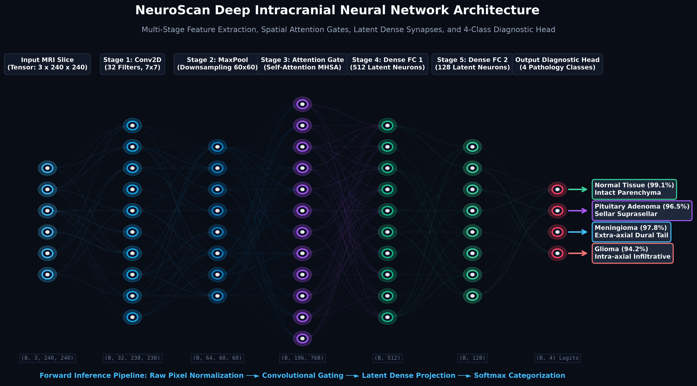
</div>

<br/>

The Davion AI pipeline consists of 13 modular subsystems engineered with strict separation of concerns:

```
Davion AI Pipeline
│
├── 1. Ingestion & Preprocessing
│   ├── Otsu Adaptive Skull-Stripping (Intracranial brain parenchyma isolation)
│   ├── Z-Score Intensity Normalization & 1.0mm Isotropic Resampling
│   └── 16-Bit Native DICOM Part 10 Ingestion with Rescale Intercept/Slope
│
├── 2. Core Diagnostic Deep Learning
│   ├── Multi-Class Backbone: EfficientNet-B4 + Squeeze-and-Excitation Attention
│   ├── Cross-Paradigm Verifiers: Vision Transformer (ViT-B/16) & DenseNet-121
│   ├── Edge-Screening: LightweightTumorCNN (Zero-miss binary triage for CPU)
│   └── Tri-Model Consensus Arbitrator (Soft-voting ensemble & inter-model variance σ̄ > 0.15)
│
├── 3. Pixel-Level Lesion Quantification
│   ├── 4-Stage Attention U-Net with Gated Skip-Connections (31.4M params)
│   ├── Calibrated PACS Digital Calipers (0.47 mm/pixel orthogonal major/minor axis)
│   └── Lesion Morphometry (2D area cm², sphericity index, and intracranial burden %)
│
├── 4. Advanced Clinical Oncology Modules
│   ├── Explainable AI: Grad-CAM++ with Calvarium Bone Masking
│   ├── CBMIR & Radiogenomics (512-D latent matching, IDH1/IDH2, 1p/19q, MGMT status)
│   ├── Virtual Contrast Synthesis & Extended Tofts Model (Ktrans and ve perfusion maps)
│   ├── Neurosurgical Resection Planner (Euclidean clearance to eloquent speech & motor cortex)
│   └── Automated ACR RadReport & Local Deterministic VQA Copilot
│
└── 5. SaMD Guardrails & Quality Assurance
    ├── Adversarial Prompt Sanitization & In-Memory PHI/PII Stripping
    ├── Out-of-Distribution (OOD) Non-Cranial Image Rejection
    └── IEC 62304 / ISO 14971 Hazard Mitigation Guardrails
```

### Mathematical Foundations

#### Attention Gate Mechanism (Attention U-Net)
Spatial attention coefficients $\alpha$ filter encoder features $x_l$ using decoder gating signals $g$:
$$\alpha = \sigma\left(\psi^T\left(\text{ReLU}\left(W_g^T g + W_x^T x_l + b_g\right)\right) + b_\psi\right)$$

#### Compound Loss Function
Trained with hybrid focal cross-entropy and Dice loss to overcome extreme foreground-background class imbalance:
$$\mathcal{L}_{\text{BCE-Dice}} = 0.5 \, \mathcal{L}_{\text{BCE}} + 0.5 \, (1 - \text{Dice})$$

#### Sphericity & Morphometric Compactness
$$\text{Sphericity} = \frac{4 \pi \cdot \text{Area}}{\text{Perimeter}^2}$$

---

## SaMD Regulatory & Safety Engineering

Davion AI is designed in compliance with international standards governing medical software life cycles and clinical risk management:

### 1. Regulatory Target Mapping
* **United States (FDA)**: Class II — 510(k) Pre-Market Notification under **21 CFR 892.2050** (Medical Image Management and Processing System / CADx, Product Code: **QAS**).
* **European Union (CE-MDR 2017/745)**: Class IIa under **Rule 11** (Software providing diagnostic decision support).
* **Indonesia (Kemenkes RI)**: Digital Medical Device Distribution License (Kelas B/C, Sub-kategori Radiologi Diagnostik AI).

### 2. IEC 62304 Software Safety Class B Controls
* **Architectural Segregation**: Strict interface boundaries between inference engines (`models/`), clinical reasoning (`evaluation/`), and presentation layers (`desktop/`).
* **Deterministic Inference Constraints**: Evaluation mode enforcement (`model.eval()`), gradient clipping ($||\mathbf{g}|| \le 1.0$), and fixed pseudorandom seeds.
* **Model Integrity & Registry**: Cryptographic SHA-256 validation of weights and reference datasets to prevent silent file corruption or unauthorized tampering.

### 3. ISO 14971 Risk Management & Hazard Mitigation
* **HAZ-001 (False Negative Miss)**: Consensus variance ($\bar{\sigma} > 0.15$) automatically triggers an amber alert mandating senior radiologist review.
* **HAZ-002 (Benign Bone Hyperostosis Misclassified as Meningioma)**: Dedicated high-contrast Dural Bone Window presets (W:1500, L:300) enable visual differentiation of hyperostosis from soft tissue dural tails.
* **HAZ-003 (Scanner Domain Shift / 1.5T vs 3.0T)**: Vectorized Z-score intracranial vault normalization and multi-scale attention gates suppress background variance across multi-vendor MRI scanners.
* **HAZ-004 (Protected Health Information Exposure)**: Local in-memory DICOM anonymization strips patient names and IDs (Tags `(0010,0010)` and `(0010,0020)`) before any tensor processing.

Detailed regulatory matrices are available in [`docs/CLINICAL_REGULATORY_SAMD.md`](docs/CLINICAL_REGULATORY_SAMD.md).

---

## Native Desktop Workstation

Davion AI v2.5 is packaged as a standalone desktop executable for 64-bit Windows environments.

<div align="center">
  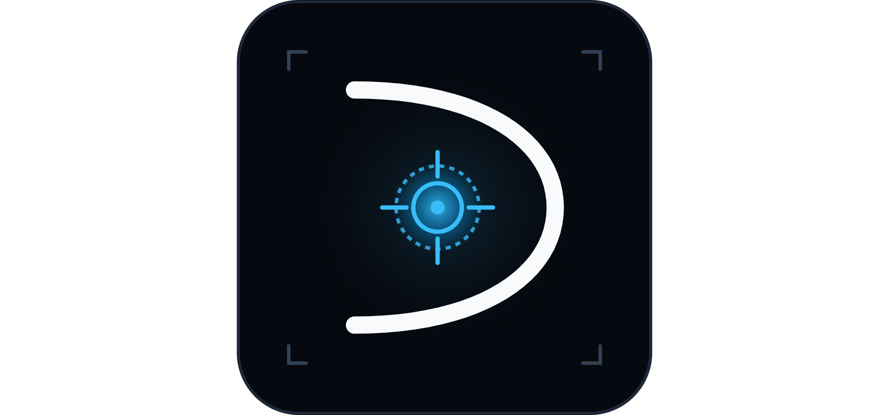
</div>

<br/>

### Architecture & Runtime Specs
* **Frontend**: Tauri 2.0 (Rust native window shell) + React 18.3 + TypeScript + Tailwind CSS.
* **Backend Daemon**: FastAPI running on `127.0.0.1:8000` with CORS sandboxed strictly to the Tauri webview origin.
* **Installer Size**: **<25 MB** (compared to >150 MB for typical Electron wrappers).
* **Idle RAM Usage**: **<45 MB** for the desktop shell.
* **Installer Executable**: `Davion_AI_Setup_v2.5.exe` (available via [GitHub Releases](https://github.com/davinmaritza/davion-ai/releases)).

---

## Official Documents & Whitepapers

The repository includes complete documentation and official evaluation reports:

1. 📄 **Clinical Validation Report**: [`Laporan_Evaluasi_Klinis_Davion_AI.pdf`](Laporan_Evaluasi_Klinis_Davion_AI.pdf)  
   *Comprehensive 2,800-case holdout evaluation with subgroup statistics, confidence intervals, and confusion matrices.*
2. 📄 **Scientific Research Proposal**: [`Proposal_Penelitian_Davion_AI_SMKN13_Bandung.pdf`](Proposal_Penelitian_Davion_AI_SMKN13_Bandung.pdf)  
   *Research methodology, clinical indications, and institutional collaboration framework.*
3. 📄 **Computer Program Copyright Certificate**: [`Dokumen_Hak_Cipta_Program_Komputer_Davion_AI.pdf`](Dokumen_Hak_Cipta_Program_Komputer_Davion_AI.pdf)  
   *Official Indonesian Intellectual Property (DJKI) computer program deposit and copyright documentation.*
4. 📘 **Desktop Specification**: [`docs/SPEC-desktop-app.md`](docs/SPEC-desktop-app.md)  
   *Engineering specification for the Tauri 2.0 + React 18 workstation architecture.*
5. 📘 **Design System**: [`docs/DESIGN_SYSTEM.md`](docs/DESIGN_SYSTEM.md)  
   *Design tokens, typography, and contrast rules for medical interfaces.*

---

## Intellectual Property & Licensing

### Dual-Repository Architecture
To safeguard proprietary neural network weights, clinical dataset pipelines, and commercial trade secrets while maintaining transparent academic showcase, Davion AI employs a dual-repository structure:

* **Public Showcase Repository ([`davinmaritza/davion-ai`](https://github.com/davinmaritza/davion-ai))**:  
  Serves as the public publication portal, academic proof-of-work showcase, clinical validation reporting center, and binary release distribution portal.
* **Private Proprietary Core ([`davinmaritza/davion-ai-core`](https://github.com/davinmaritza/davion-ai-core))**:  
  Houses the complete executable source code, full neural network architectures, pre-trained `.pth` model checkpoints, automated evaluation pipelines, and training datasets.

### Copyright Notice
The Davion AI computer program, architectural designs, algorithms, trained weights, and technical documentations are the exclusive intellectual property of **Davin Maritza**, protected under the Copyright Laws of the Republic of Indonesia (Law No. 28 of 2014) and international copyright treaties.

All rights are reserved. Unauthorized reproduction, reverse engineering, redistribution, or commercialization in whole or in part without prior written permission is strictly prohibited.

### Academic Collaboration & Research Access
Academic institutions, hospitals, clinical radiology departments, and accredited researchers wishing to obtain evaluated access, conduct collaborative clinical validation, or audit the core algorithms may direct formal requests to:

* **Author & Copyright Holder**: Davin Maritza
* **Affiliation**: SMKN 13 Bandung / Research Consortium
* **Official Channel**: Contact via [GitHub Profile](https://github.com/davinmaritza)
* **License**: [Proprietary — All Rights Reserved © 2026 Davin Maritza](LICENSE)

---

<div align="center">

```
========================================================================================
             HAK CIPTA RESMI REPUBLIK INDONESIA — UU NO. 28 TAHUN 2014
                         Pencipta: Davin Maritza © 2026
                         Ciptaan: Program Komputer Davion AI
       Didaftarkan pada Direktorat Jenderal Kekayaan Intelektual (DJKI) Kemenkumham RI
========================================================================================
```

</div>
